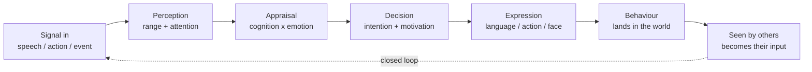
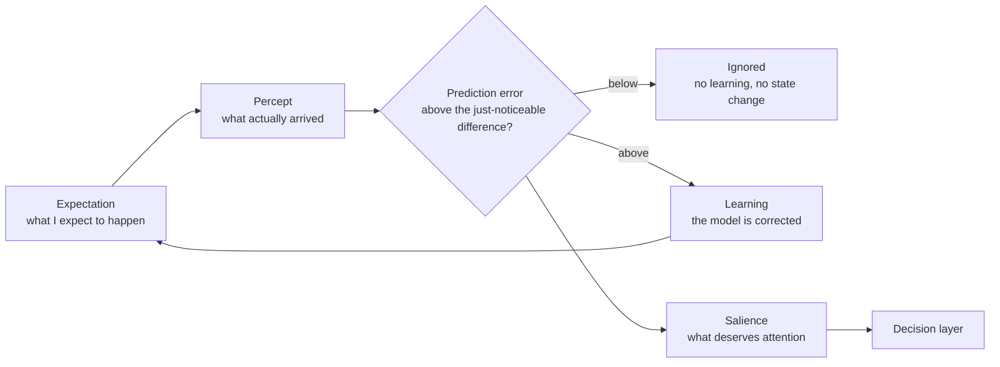
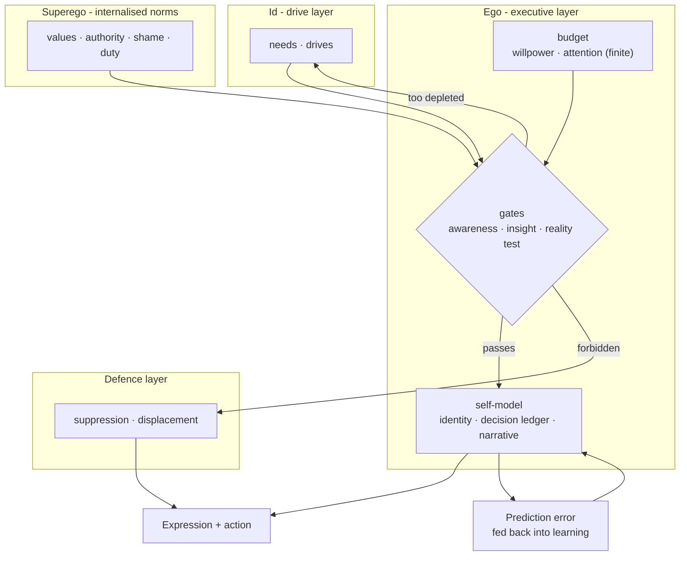

# GC — Modeling Minds in a Simulated Society

##### _An Experimental Study of Memory, Attention, Personality, and Social Context_

## Join the Future Beta

Ghost City is currently under final testing. 

Creators, writers, self-shippers, worldbuilders, and explorers from all regions are welcome to register their interest. Beta participation will depend on testing capacity, platform availability, and regional accessibility.

If you are interested in exploring the project in a future testing phase, you can register your interest below.

[**Register for the Future Beta →**](https://forms.gle/YSZ55ziK8FC81reH6)

*Submitting this form registers your interest only and does not guarantee access to the beta.*

---

## Contents

- [1. The problem](#1-the-problem)
  - [Why I start this project](#why-i-start-this-project)
  - [Academic Purpose](#academic-purpose)
  - [Practical and Commercial Purpose](#practical-and-commercial-purpose)
- [2. What I built, and what it can and cannot say](#2-what-i-built-and-what-it-can-and-cannot-say)
  - [How the pieces relate](#how-the-pieces-relate)
  - [The claims, and the rival accounts they must beat](#the-claims-and-the-rival-accounts-they-must-beat)
- [3. How I know it works](#3-how-i-know-it-works)
  - [What is the experiment like](#what-is-the-experiment-like)
- [4. The prediction loop, measured](#4-the-prediction-loop-measured)
- [5. Limits](#5-limits)
- [6. What I will do next](#6-what-i-will-do-next)

---

## 1. The problem

A character written with a language model is effectively re-described each time it speaks. Its personality lives in a prompt, its memory in a text window, and its behavior is whatever the model finds plausible at that moment. Three failures follow from this architecture, and these are the failures I set out to study.

**They do not reliably remain the same person.** Ask the same character the same question a week later, and its temperament may shift because little outside the prompt maintains a persistent internal state.

**They do not live when nobody is watching.** Events exist primarily in response to the user. The world is a stage that comes alive during a conversation and goes quiet when the conversation ends.

**And their actions are difficult to explain causally.** The decision is produced inside the model, making statements such as “he refused because he was exhausted” an interpretation after the fact rather than a traceable causal account of the decision.

These limitations led me to a different design question: *__what would happen if a character's behavior emerged from persistent internal state, environmental events, and social context rather than from the immediate prompt alone?__*

### Why I start this project

This project has two purposes. **Academically, I want to investigate whether an artificial cognitive system with persistent internal states can produce reproducible cognitive and social behavior. Practically, I want to develop such a system into a simulated society that people can actually enter and use.**

#### Academic Purpose

Large Language models can produce remarkably human-like language, but this resemblance often exists only within a single interaction. My question is different: if an artificial character has persistent memory, perception, bodily states, expectations, personality, and social relationships, can its behavior continue to emerge from these internal states and environmental relationships rather than being generated solely by the immediate prompt?

For this reason, I design this project as an artificial social system that can be tested, measured, and potentially falsified. My goal is to investigate whether **stable patterns of behavior can emerge when cognition is decomposed into traceable mechanisms such as memory, perception, bodily state, prediction, and social context.**

This is also the central academic value of the project at its current stage. The system provides a controlled environment in which cognitive phenomena that are difficult to observe directly can be translated into measurable internal variables. The current results can only establish that these mechanisms operate within the system I built. Whether they can explain aspects of real human cognition requires further studies and external validation.

#### Practical and Commercial Purpose

On the practical side, I want to develop the experimental system into a **simulated society** that people can actually enter and use.

Rather than simply chatting with a single AI character, users would enter a persistent world populated by multiple characters with different memories, personalities, cognitive states, and social relationships. These characters can continue to act even when the user is not interacting with them, with their behavior shaped by their past experiences, current states, and relationships with others.

The commercial goal, therefore, is to explore a different form of AI interaction: **instead of generating a conversation whenever the user opens an application, the system provides a world that continues to exist and evolve on its own.**

If the system can produce stable differences between characters, persistent memory, and social behavior that is predictable without being completely fixed, it could eventually become a new form of interactive entertainment, narrative experience, and AI-based social product. At the same time, real-world use could provide a larger environment for further testing and iteration under controlled conditions.

## 2. What I built, and what it can and cannot say

I built a character-simulation system within a simulated social environment. 

I designed a computational framework in which memory, perception, cognition, decision-making, and social context interact to shape personality and behavior.

The whole engine is one loop. Everything that happens inside a character enters at the left and
leaves at the right; what leaves becomes somebody else's input, which is why the world does not
need a narrator.

A character may only react to what reached it through **perception**, its reaction is chosen by **appraisal and decision**, and whatever it does lands in the same world that other characters perceive. Each of the experiments below tests one edge of this loop.

| Commitment                                                                                      | Why it is unusual                                                                    |
| ----------------------------------------------------------------------------------------------- | ------------------------------------------------------------------------------------ |
| Objects may only **inject signals** into one another; no object writes another object's numbers | explainability is enforced at the boundary                                           |
| The language model is a **translator, never the decision maker**                                | wording varies between runs; the decision is owned by the engine and is reproducible |
| **Perception is bounded**                                                                       | a character can genuinely miss what was said                                         |
| Behaviour depends on the **body** rather than only on the prompt                                | the same sentence meets a different person when that person is depleted              |
| Individuality is **computed from the description**, not asserted in a prompt                    | differently-worded characters diverge measurably, in ways the engine can name        |
| **A memory is not stored forever**                                                              | a remembered event loses its detail first and its existence later                    |
| The **world keeps moving while the user is absent**                                             | absence is a state of the world                                                      |

### How the pieces relate

The engine predicts before it perceives, and the correction is gated: an error below the
just-noticeable difference changes nothing. This is the part of the design I care most about,
because it means "he did not react" can be a real outcome rather than an omission.

Drive, executive gate, internalised norms and defence here are separate layers with separate inputs, and the executive layer has a **finite budget**, so depletion changes what gets through.

### The claims, and the rival accounts they must beat

Each design commitment above is a claim that could be wrong. Below is what it competes with, what
separates them in my data, and what is still missing.

| Claim                                                               | The rival account                                                                                                   | What separates them                                                                                                              | Still missing                                                        |
| ------------------------------------------------------------------- | ------------------------------------------------------------------------------------------------------------------- | -------------------------------------------------------------------------------------------------------------------------------- | -------------------------------------------------------------------- |
| Perception is bounded; failing to notice is informative             | attention-resource accounts make a miss a low probability                                                           | E5: the miss is condition-dependent (asleep + whisper at 14 m is missed 8/10) while the matched control is perceived 10/10       | a human comparison group; this result is model-internal              |
| Memory weathers in two stages: detail first, existence later        | exponential and power-law forgetting predict one monotone decline, with no gist-vs-gone distinction                 | E6: per-memory transition days, the two transitions ordered, dispositions decaying at different speeds                           | fitting against human retention data; more than a few dispositions   |
| Bodily state reaches the decision                                   | appraisal-only models put fatigue inside the evaluation of the stimulus, so an unchanged appraisal keeps the action | E10: the stimulus is held constant within one character, and the decision shifts in 3 of 3 dimensions — a **small** effect (~3%) | an effect-size comparison with human sleep-deprivation studies       |
| An expectation has two faces, and the intuitive one is quantitative | single-channel prediction (a low-pass filter, or a scalar prior) can never expect anything unperceived              | E16: four never-perceived signals enter the expectation (0.9975 expected vs 0.0684 self-generated)                               | evidence that it predicts **behaviour** better than a single channel |

## 3. How I know it works

Everything in this section comes from the same kind of run, so it is worth saying what a run is
before showing any numbers.

### What is the experiment like

A run is a single command that drives the character offline. No user, no chat window, and the
language model switched off, so nothing that happens can be blamed on wording. The engine writes a
row per decision cycle, so a result is a column of numbers a reader can re-tabulate.

Four things are fixed before any number is looked at:

- **a protocol** — what is held constant, and what is varied;
- **a control that must come out the other way** — the same code path, with the mechanism expected to
  be silent, so "it moved" cannot be explained by the act of measuring;
- **a disproof condition, stated in advance** — "if X happened, this claim is dead", written before
  the run rather than after it.

The experiments below are the ones I would defend in a conversation, and the remaining groups stay in the repository as supporting material.

| Dimension | Evidence | Sample Size | What Would Have Disproved It |
|---|---|---|---|
| **Reproducibility (E12)** | Ten hand-written descriptions were compiled three times each, in three different orders: every run returned a byte-identical profile, and every description produced a profile no other description produced. The control is what makes it a result — each description was then edited by one word and recompiled, and all ten edits were detected.  *So "who she is" is a computation rather than the mood of the system.* | *n = 10 descriptions × 3 runs + 10 mutations.* | One description compiling differently on a second run, or by a one-word edit that left the profile unchanged. |
| **Individuality (E2)** | The same procedure applied to twenty different records produced twenty personalities that are all distinguishable from each other, spread across five families, with the least and most expressive separated by 0.40 to 0.83 on a normalised scale.  *Individuality is generated.* | *n = 20 descriptions.* | Two descriptions producing the same profile. |
| **Autonomy (E3)** | Forty cycles with no input at all and the model cut off: forty distinct behavioural states, thirty-nine changes, three moods, and no speech, because speech is reserved for being addressed.  *The behaviour is the simulation's instead of the model's.* | *n = 40 cycles, zero input.* | One identical state repeated across all forty cycles. |
| **Memory (E6)** | Eight events followed for a year across three temperaments. Detail went first (the concrete version lasted 65 to 184 days depending on the person), existence later (75 to 224 days); a year on, five of twenty-four memories were still concrete.  *Forgetting is gradual, ordered, and person-specific.* | *n = 8 events × 3 temperaments, followed for 365 days.* | Every memory decaying at the same rate, or by detail outliving existence. |
| **Embodiment (E10)** | The same character met the same twelve situations twice: rested, then after a night without sleep. The action changed in eleven of twelve, the emotion in twelve of twelve, and all three measured dimensions of the planned movement shifted, with the model blocked throughout.  *State, not wording, decides.* — with the caveat that the largest shift is \~3 to 11%, so this is a direction rather than a magnitude. | *n = 12 situations × 2 body states, within one character.* | A decision that did not move when the body did. |
| **Growth (E7)** | One character, thirty simulated days, sixty cycles, no input: the inner state moved every cycle in small steps, and a second run of the same month from the same start reproduced **all sixty cycle signatures**.  *He develops, and the development is reproducible.* | *n = 60 cycles over 30 simulated days.* | A flat trajectory, or by a rerun that disagreed with the first. |
| **Perception (E5)** | **A weaker result.** Perception is a self-consistency check: the thresholds are the engine's own, and the control (6 m, daylight, perceived 10/10) is deliberately easy. What it does establish is that a miss is a real, condition dependent outcome — asleep with a whisper fourteen metres away he missed it eight times out of ten, while a shout at the same distance arrived every time. | *n = 80 trials across 8 conditions.* | The control being missed, or every condition behaving identically. |
| **Safety (E11)** | **A weaker result.** Safety measures both directions: of thirty-two harmful prompts, 9 of 24 Chinese ones were intercepted (37.5%) and 1 of 8 English ones (the English arm is too small to claim anything); of thirty-two harmless prompts, none was blocked.  *The gate fires, and it did not over-fire on the material tested.* | *n = 32 harmful + 32 benign prompts.* | Nothing being intercepted at all, or false positives above twenty per cent. |

The demonstration conversation ships alongside these, and it is explicitly **not** a measurement: a
language model's output is not repeatable, so it is evidence of behaviour.

## 4. The prediction loop, measured

The part of the design I care most about is the one I could least honestly claim: the engine should
expect something **before** it meets it, and the gap between the two should be what causes a change.
When I first instrumented that loop it was not predicting at all. It was reciting.

Three separate causes:

1. **Nothing was ever written down for it to read back.** Things were stored without the information
   the expectation needs, so the expectation was always empty and nothing looked broken, because the
   store itself was full.
2. **It was reading from the wrong place.** The first attempt wrote to a store the reader never opens,
   and the failure was swallowed.
3. **Once those were fixed, it still recited.** The newest record was counting as part of its own
   expectation, so whatever arrived was always already expected: the gap was exactly zero.

The third one needed a definition: **known** has to mean *met repeatedly* rather than *just met once*. With that, the same thing happening again produces a real and measurable gap that shrinks as the expectation forms.

Then a deeper limit appeared: an expectation built only from what has already happened is a filter,
not a forecast. That means that it can never expect anything it has not already met. So the engine now also carries the **relations between kinds of events. A kind it has met many times brings its related kinds with it: after a session in which only two kinds of things had ever happened, what he expected included four that had never happened at all**. That is the step from recitation to anticipation, and it is measured.

Two further pieces are now explicit:

- **Order is checked.** Every expectation is stamped when it is formed and verified when
  the actual thing is received; the experiment checks this on every trial, so a future change that
  reverses the two cannot pass silently.
- **He can be braced for something on two levels at once.** Meeting a thing can be a matter of what it
  is, and also of *how it sits with* what he was braced for - two people can be dealing with the same
  thing and still be out of step with each other. Being "out of step" is a number here, and it is measured twice with the same result.

The honest limit of this section: what is measured is the loop's behaviour inside the engine instead of its power to predict anything about a real person.

## 5. Limits

- **Everything above is engine-side.** Four of my own instruments failed during this work: one claim was withdrawn, one hypothesis was refuted and subsequently re-scoped, one measurement could not distinguish between its candidate explanations, and one supposedly reproducible trajectory turned out to depend on a frozen clock. I consider this distinction important. One demonstration run using a local model is included in the report, but it is explicitly presented as a demonstration. No human participants were involved, so the system has no external validity at this stage. Every “still missing” cell in Section 2 points to the same limitation: the current evidence describes the behavior of the system I built, not yet the behavior of people.

- **The long trajectory still requires a frozen clock and a clean reproduction protocol.** The safety gate is also a partial filter, with its weakest performance occurring in English-language phrasing. For that reason, the current pilot remains invite-only.

## 6. What I will do next

The experimental system has completed its initial validation stage. The next phase is an invite-only pilot designed to evaluate how external users interact with the simulated society. 
